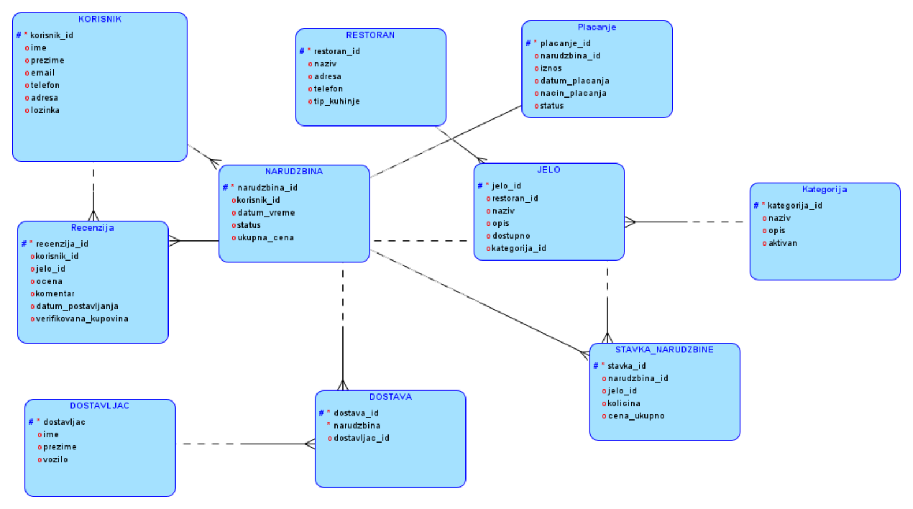
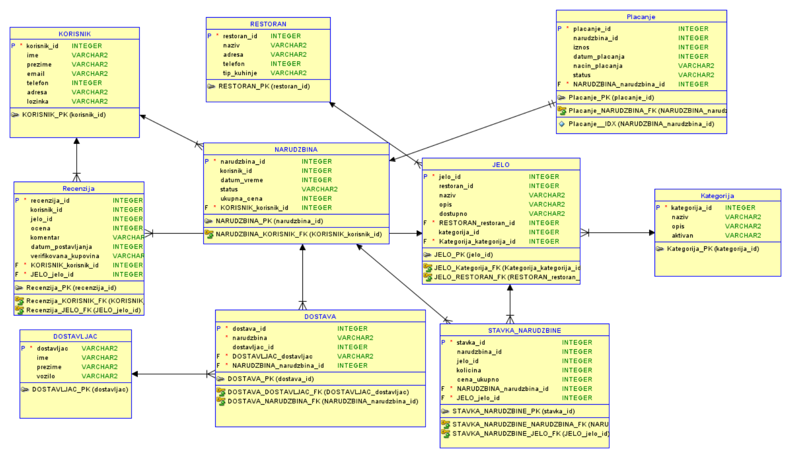

# Food Delivery Database

A relational database for a food delivery system, designed and implemented as my final high-school project (Databases). Designed with Oracle SQL Developer Data Modeler and implemented in **Microsoft SQL Server (T-SQL)**.

## What the system covers

Users register and browse restaurant menus, place orders made of several items, pay by cash or online, and leave reviews. Couriers pick up and deliver orders, and every delivery is tracked.

## Data model

10 tables: `Korisnik` (users), `Restoran` (restaurants), `Kategorija` (categories), `Jelo` (dishes), `Narudzbina` (orders), `StavkaNarudzbine` (order items), `Dostavljac` (couriers), `Dostava` (deliveries), `Placanje` (payments), `Recenzija` (reviews).

- Primary keys use `INT IDENTITY`; relationships are enforced with foreign keys.
- `StavkaNarudzbine` resolves the many-to-many relationship between orders and dishes.
- Data types: `NVARCHAR` for text (Serbian diacritics), `DECIMAL(10,2)` for money, `BIT` for flags.

| ER diagram | Relational model |
|---|---|
|  |  |

## How to run

1. Open the scripts in SQL Server Management Studio (files are UTF-8).
2. Run in order:
   - `sql/01_create_tables.sql` - creates the database and tables
   - `sql/02_insert_data.sql` - inserts sample data
   - `sql/03_queries.sql` - example queries

## Example queries

`sql/03_queries.sql` contains 10 examples:

- filtering and `JOIN`s across 2-3 tables (available dishes, orders per user, dishes by category)
- aggregation with `GROUP BY` (revenue per restaurant, average rating per dish, best-selling dishes)
- T-SQL `CURSOR`s for row-by-row processing (expensive dishes, undelivered orders)

## Possible improvements

- Store password hashes instead of plain text (sample data only uses dummy passwords).
- Add `NOT NULL`, `UNIQUE` (e.g. email) and `CHECK` constraints (e.g. rating between 1 and 5).
- Add indexes on foreign keys and frequently filtered columns.
- Calculate order totals with a view or trigger instead of storing them manually.
- Add stored procedures for placing an order.
